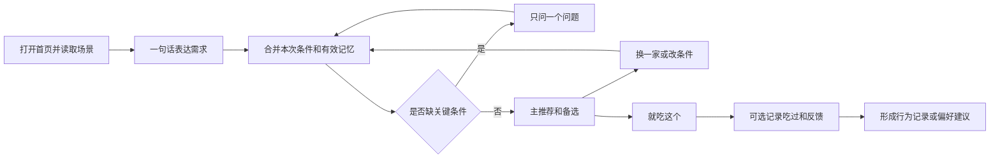

# 饭点搭子产品设计

饭点搭子帮助学生结合时间、地点、预算和饮食偏好，快速决定这一顿吃什么。原型的核心体验是：用户说一句话，得到一个主推荐和最多两个备选；说“换一家”“便宜点”即可继续调整；明确表达的偏好会在下次生效，并且随时可以查看、修改和删除。

本设计依据仓库 `readme.md`，按 **由 Codex 负责开发、单校区、移动端 Web 原型**规划。比赛截止时间尚未给出，采用可验收里程碑推进，不依赖多人并行开发；下文数量和性能均为设计目标。默认“仓库内的食物”指项目维护的校园餐食目录，不代表已有食堂或外卖平台数据接口。

## 1 产品定位与价值

主要用户是经常在食堂、校内商家和外卖之间犹豫的学生。优先解决三个问题：选择耗时、信息难比较、每次都要重说偏好。

产品承诺是“给出有依据、能行动的吃饭建议”。首屏围绕这一顿展开，不要求用户先浏览菜单，也不要求每天填写完整问卷。

比赛展示的三个重点：

1. **理解当下**：同一个用户，雨天、赶课、月底预算紧时得到不同推荐。
2. **连续调整**：一句“换一家”只替换候选，保留预算、忌口和时间限制。
3. **记忆可控**：一句“以后别推奶茶”影响下一次推荐；记忆卡显示来源、有效期和撤销入口。

北极星指标为“发起吃饭决策后，60 秒内选择一个方案的会话比例”。选择只表示形成决策，不等于下单、付款或实际吃过。

## 2 MVP 范围

| 优先级 | 功能 | 原型完成标准 |
| --- | --- | --- |
| P0 必做 | 注册登录与新手标签 | 用户名密码注册；可用隔离的访客身份体验；完成标签后首次推荐可用 |
| P0 必做 | 场景感知 | 当前时间自动读取；校区与楼栋手选；可录入本次最晚结束时间；天气可切换演示场景 |
| P0 必做 | 对话推荐 | 一句话生成主推荐和最多两个备选，展示价格、时间、理由和数据来源 |
| P0 必做 | 连续条件调整 | 支持换一家、便宜点、快一点、清淡点，保持其他条件 |
| P0 必做 | 选择与反馈 | 记录“就吃这个”；另行记录“吃过了”和可选实际支出、反馈 |
| P0 必做 | 记忆闭环 | 注册标签和自然语言偏好共用同一份记忆；可修改、忘记和撤销 |
| P0 必做 | 食物目录接入 | 一套本地种子数据，建议 6 家商户、24 道餐食；通过 MCP 薄层查询 |
| P0 必做 | 用户记忆资料包 | 每次已确认记忆改变后，生成版本化资料；普通用户看自然语言记忆卡 |
| P0 必做 | 可重复演示 | 切换雨天、晚课、预算变化场景；重置演示账号；模型故障可用规则推荐 |
| P1 加分 | 轻量 RAG | 检索档口介绍、连廊路线和规则文档，答案附来源 |
| P1 加分 | 首页主动建议 | 打开首页时按当前场景和已记录行为展示一条可关闭建议 |
| P1 加分 | 近期记录与统计 | 基于明确记录展示选择、用餐和支出；说明统计覆盖范围 |
| P1 加分 | 数据维护界面 | 编辑售罄、营业时间和预估排队；P0 使用受控种子文件和导入脚本 |
| P2 后续 | 外部数据和提醒 | 课表导入、地图路线、天气 API、合作商户菜单、订阅提醒 |
| P2 后续 | 多人决策 | 每个人独立填写约束，取交集后推荐；P0 只接受发起人的本次人数和人均预算 |

P0 不包含支付、真实外卖订单同步、优惠券抓取、完整营养管理、跨校区运营和自动订餐。外卖方案由团队录入或演示数据提供，不能在未接通平台时展示“实时到手价”。

## 3 页面与用户路径

### 3.1 页面结构

移动端底部保留“吃什么”“记录”“我的”三个入口。对话是首页的主体，食物详情、偏好编辑和反馈使用抽屉，尽量避免跳转打断决策。

| 页面 | 主要内容 | 关键操作 |
| --- | --- | --- |
| 欢迎与登录 | 一句话价值说明，注册、登录、体验入口 | 开始体验 |
| 初始设置 | 校区楼栋、分组标签、记忆设置 | 跳过可选项，开始推荐 |
| 吃什么 | 场景栏、对话、推荐卡、快捷调整 | 输入一句话，就吃这个 |
| 餐食详情抽屉 | 菜品、商户、原料信息、价格构成、时间构成、来源 | 查看路线文字，选择方案 |
| 记录 | 最近选择、明确记录的用餐、反馈 | 标记吃过了，修改实际花费 |
| 我的 | 饮食记忆、临时偏好、账号和隐私设置 | 修改标签、忘记、撤销、关闭记忆 |
| 演示控制面板 | 时间、天气、售罄状态和样例账号 | 切场景、恢复种子数据；仅演示环境启用 |

桌面端使用左侧对话、右侧推荐或记忆详情的双栏布局。演示面板放在开发者入口，普通用户页面不出现模型调用、MCP、向量库等技术术语。

### 3.2 首次使用

流程：注册或访客体验 → 选择校区楼栋 → 点击建议的 5–8 个标签 → 进入对话。

标签不强制凑满数量。预算、忌口优先展示；品类放最后，允许用户完全不知道想吃什么。首次设置控制在一个短流程内，普通账号支持用户名密码；P0 不依赖短信、邮箱验证或校园统一认证。

| 分组 | 示例 | 选择规则 | 默认作用范围 |
| --- | --- | --- | --- |
| 目标 | 吃饱、省钱、吃好点、减脂、增肌 | 主目标单选，允许不设置 | 长期，可修改 |
| 口味 | 清淡、麻辣、酸辣、甜口 | 多选；互相冲突时解释或要求选主偏好 | 长期软偏好 |
| 预算 | 15 元内、25 元左右、35 元、不限 | 单选，可自定义；区分上限和目标值 | 长期默认 |
| 节奏 | 赶时间、慢慢吃、边走边吃 | 单选 | 本次默认；首页随时改 |
| 场景 | 一人食、和同学、早餐、夜宵 | 人数与餐次分开存 | 本次有效 |
| 忌口 | 不吃香菜、不吃牛羊、素食、不吃辣 | 多选，可补充；与一般“不喜欢”区分 | 明确禁忌长期生效 |
| 过敏信息 | 选择过敏原或填“未提供” | 单独询问和展示，不与口味混为一项 | 明确约束 |
| 品类 | 米饭、面食、轻食、汤、奶茶咖啡 | 多选，可跳过 | 长期软偏好 |

“25 左右”表示排序偏好；“最多 25 元”表示硬上限。“喜欢麻辣”与“不吃辣”不能同时作为有效偏好。用户选择过敏原时，原料或交叉接触信息不充分的菜品不得标为“适合过敏人群”。

未授权定位时用手动选择的楼栋，不阻断使用。无课表时只识别“午餐时段”，不声称用户刚下课。README 开屏示例中的时间、天气、位置和课表只有确实获得时才同时使用。

### 3.3 一次吃饭决策

一次只追问一个最影响结果的问题。已有可靠答案时不再问；可以使用默认值时明确展示。例如“按你平时 25 元左右找”，用户直接点预算标签修改。

常见追问与处理：

| 输入 | 系统行为 |
| --- | --- |
| 今天中午吃什么 | 使用当前校区、餐次和已知偏好；缺校区才询问 |
| 换一家 | 排除当前主推荐商户，保留其他条件；备选耗尽时解释 |
| 便宜点 | 优先找比当前主推荐便宜的可行方案；不降低已知忌口约束 |
| 快一点 | 以完整用餐时间重排，不只比较外卖配送时间 |
| 太辣了 | 降低本次辣度；提供“以后也少辣”的轻量入口 |
| 这周手头紧，每顿最多 15 | 本周预算上限设为 15；展示到期时间 |
| 今天请同学，人均 35 | 本次人数和预算覆盖长期默认；不永久改预算 |
| 以后不推荐奶茶 | 保存长期排除偏好，显示“已记住，可撤销” |
| 我不减脂了 | 终止此前目标；不反向推断用户开始增肌 |

### 3.4 推荐卡设计

每次默认只展示 1 个主推荐和最多 2 个备选。主推荐回答“吃什么、在哪、多少钱、什么时候能吃完、为什么适合你”。

示例为虚构演示场景：当前 12:00，13:00 需到教室，预算最多 20 元，偏好清淡。

> **主推荐：食堂二楼番茄鸡蛋饭**  
> 预估 14 元｜约 12:44 到教室，距 13:00 上课预留 16 分钟  
> 步行 6 + 排队 8 + 出餐 3 + 用餐 15 + 到教室 7 + 缓冲 5 = 44 分钟  
> 符合你本次 20 元以内的预算，也满足清淡偏好。  
> 数据：演示菜单；排队为场景估计。  
> 操作：就吃这个 · 换一家 · 便宜点 · 看详情

时间计算由程序完成，说明中显式包括假设。排队时长是估计时，不能渲染成保证。真实模式宜显示区间；演示固定值用于复现。

详情中的价格拆成菜价、配送费、包装费、已核验且满足条件的优惠。多人场景同时展示总价和人均。无营养来源时不展示精确热量；“低油”需要菜单或商户信息支持，不从菜名自动推断医学效果。

### 3.5 选择和反馈

“就吃这个”保存决策，不创建真实订单。之后用户可点“吃过了”，补充是否喜欢、太辣、太贵、排队久、分量不足和实际花费。用户不反馈时保留为“已选择、未确认用餐”。

单次“太辣”是一次反馈；明确“以后都别这么辣”才改长期偏好。重复行为可以形成待确认建议，如“最近几次都选了清淡，要把默认口味改为清淡吗？”

支出统计只累计用户确认的实际金额，单列估算值；未连接订单平台时，使用“你在饭点搭子记录的支出”，不能声称掌握全部月消费。

## 4 记忆和标签体系

### 4.1 统一入口与作用范围

注册标签、设置页修改、对话表达，最终都修改同一份结构化偏好。界面上的 TAG 是记忆的展示方式，不另建一份可能冲突的数据。

| 记忆类型 | 例子 | 生效与失效 |
| --- | --- | --- |
| 长期显式偏好 | 不吃香菜、平时预算 25、喜欢面食 | 用户明确表达后保存，直到修改或忘记 |
| 临时偏好 | 这周每顿最多 15 | 带开始和结束时间，到期恢复长期默认 |
| 本次状态 | 三个人、今天想吃辣、这顿预算 35 | 仅当前决策；选择、结束或超时后失效 |
| 行为记录 | 选过某餐、明确记录吃过、拒绝某商户 | 保留事件语义；不能自动等同于长期喜恶 |
| 推断候选 | 可能更喜欢清淡 | 仅建议，确认后转为有效偏好 |

通常按“本次明确条件 → 有效临时偏好 → 长期默认 → 场景默认”合并。过敏和明确禁忌需单独校验；“今天想尝鲜”不能覆盖过敏约束。解除过敏记录时需要明确的设置操作或确认，修改一般口味则直接生效。

“这周”按用户时区计算至本周日结束，以周一零点作为排他的失效边界。“最近”没有明确截止日期时保存为待确认建议，不擅自变成永久事实。

### 4.2 记忆页

记忆页分为“长期偏好”“正在生效的临时偏好”“待确认建议”。每张卡展示：自然语言内容、来源、适用范围、有效期和修改入口。

例如：“本周每顿最多 15 元；来自今天的对话；周日后失效。”支持编辑、提前结束、忘记，以及最近一次明确修改的撤销。撤销是一次新修改，不把整个用户画像倒退到旧版本。

默认开启“记住我明确说出的偏好”，推断只形成建议。用户可关闭长期记忆，随后只使用本次会话。关闭时可选择同时清除已有记忆；重新开启不得从旧会话自动恢复已忘记的内容。

“Skill 化”的用户价值是可理解、可修正、跨会话生效。普通用户不用理解文件格式；演示入口可以展示“这句话 → 记忆变更 → 新版本资料包 → 下一次推荐变化”。

## 5 主动建议

P1 先做用户打开首页时的建议，不要求后台推送权限。只有建议会改变当前决策时才展示，并允许关闭。

| 触发 | 所需证据 | 示例 |
| --- | --- | --- |
| 当前下雨 | 已获取的天气或明确标注的演示天气 | 今天下雨，优先看看有连廊的食堂？ |
| 时间紧张 | 用户录入的截止时间或已授权课表 | 距下一节课还有 40 分钟，先看近处？ |
| 预算提醒 | 设定过预算且已有实际支出记录 | 这周已记录支出 86 元，要优先看 15 元内吗？ |

同一餐次最多展示一次，忽略后本餐不再弹出。没有完整消费记录时不预测全月必然超支。减脂、控糖等是用户目标标签，产品提供一般餐食选择信息，不作治疗、血糖控制或“吃了不困”的效果承诺。

## 6 数据与异常体验

每项外部事实带来源、采集时间和性质：已核验、估计、用户填写、演示或未知。一个推荐卡可同时包含已核验菜价和估计排队时间，不能用卡片级“真实数据”掩盖字段差异。

| 情况 | 用户看到的结果 |
| --- | --- |
| 未授权定位 | 手选楼栋；保留后续推荐能力 |
| 无天气或课表 | 不声称掌握天气、下课或到课信息；只用已知条件 |
| 无可行餐食 | 解释具体冲突；一次提出一个可放宽条件，未经用户操作不放宽预算上限或禁忌 |
| 候选售罄或关门 | 撤下该方案，保留条件重选 |
| 价格或营业信息过期 | 提示需确认；不可继续作确定性承诺 |
| 外卖优惠条件未知 | 展示未优惠价格或未知，不编造满减后价格 |
| 模型故障 | 规则推荐卡仍可使用；显示“智能对话暂不可用” |
| 记忆保存失败 | 提示“本次已采用，未保存为长期偏好”，允许重试 |

原型演示数据覆盖雨天赶课、月底省钱、夜宵关门、三人用餐、偏好变更、售罄和空结果。种子数据不使用 README 中的虚拟数字充当真实商户事实。README 中时间比较、价差和营养描述只作为体验参考，实际结果由同一份数据重新计算。

## 7 演示脚本与验收

建议现场用 3 分钟展示完整变化，不依靠长篇聊天。

1. 新用户选“清淡、25 元左右、不吃香菜、米饭”，进入首页。
2. 切到明确标注的雨天场景，输入“下午一点上课，现在吃什么”。展示时间构成与主备推荐。
3. 输入“便宜点”，推荐改变，忌口和到课时间保持。
4. 输入“这周每顿最多 15，以后别推奶茶”。展示一条有期限预算和一条长期偏好，资料版本随之变化。
5. 新开一次吃饭决策，不重新填标签；推荐自动使用有效记忆。
6. 在记忆页结束本周预算限制，新一轮恢复原长期预算；展示修改确实影响结果。

| 验收项目 | 通过条件 |
| --- | --- |
| 新手流程 | 可跳过可选标签，进入第一轮推荐；访客之间数据隔离 |
| 对话连续性 | 换一家、便宜点后其他约束未丢失 |
| 推荐可追溯 | 菜名、价格、商户和时间均来自目录及程序计算 |
| 记忆一致性 | 注册、对话、设置页看到相同偏好；新会话立即使用修改 |
| 记忆生命周期 | 临时偏好到期失效，删除后不从摘要或历史中复活 |
| 结果约束 | 固定测试场景不推荐超硬预算、已关门、已售罄或违反明确禁忌的菜品 |
| 反馈语义 | 选择、吃过、实际付款金额保持区分 |
| 异常路径 | 无结果、模型超时和数据缺失均有可操作反馈 |

体验目标：收到请求后 1 秒内显示处理状态；普通推荐争取 8 秒内生成；默认追问不超过一次。长延迟时先展示已计算的推荐卡。以上目标需要选定模型和部署环境后实测。

## 8 开发里程碑

| 里程碑 | 由 Codex 完成的工作 | 验收结果 |
| --- | --- | --- |
| M0 可运行骨架 | 前端页面骨架、后端、MySQL、种子目录、启动说明 | 本地一条路径启动并看到演示餐食 |
| M1 首次决策 | 注册与标签、推荐规则、卡片、模型适配和 MCP 查询 | 用户一句话得到有依据的推荐 |
| M2 连续决策 | 决策状态、换一家、便宜点、时间价格计算和空结果处理 | 调整条件后保留其他约束 |
| M3 记忆闭环 | 记忆事务、资料包编译、编辑忘记和有效期 | 修改偏好后新会话立即生效 |
| M4 比赛原型 | 选择反馈、演示场景、模型故障降级、关键回归和部署说明 | 完整演示脚本可重复运行 |
| M5 选做增强 | RAG、主动建议、记录统计和数据维护界面 | 在主线稳定后增加有展示价值的能力 |

比赛准备时间紧张时，依次取消主动建议、统计页、RAG 和管理界面；记录页缩减为最近一次选择。保留推荐真实性、偏好修改、上下文连续性和可重复演示。用户记忆资料包采用确定性模板生成，避免把复杂自动技能创作系统塞进 P0。接入真实模型需可用的模型账号配置，公开部署需目标环境；这些配置不阻碍先完成本地演示版本。

架构与接口详见 [全栈架构设计](./全栈架构设计.md)。

## 2026-11-05 原型迭代：先接住话，再决定是否选餐

对话不再以每一轮推荐菜品为目标。用户打招呼、倾诉近况时正常聊天；追问上一轮理由时针对已推荐餐食回答；明确希望选餐或调整时才展示候选卡。回复由模型根据当前输入、近期对话和有效记忆组织，避免固定开场与重复播报价格表。

记忆同时提供“选餐时遵守的偏好”和“关于我，不止是标签”。前者保存预算、忌口等确定条件；后者保存完整的生活背景及原因，如“我最近实验很多，经常很晚才吃饭，排长队时会更烦”。明确要求记住的段落直接保存，普通近况先待确认；本人可编辑、忘记或选择保留期限。记忆页用自然语言概览帮助用户理解当前档案。

段落是聊天理解背景，不能凭此宣称已获得座位、人流、营养或实时营业信息，也不擅自改变硬预算。导出资料包含本人原文段落，删除或过期后停止用于模型上下文。
