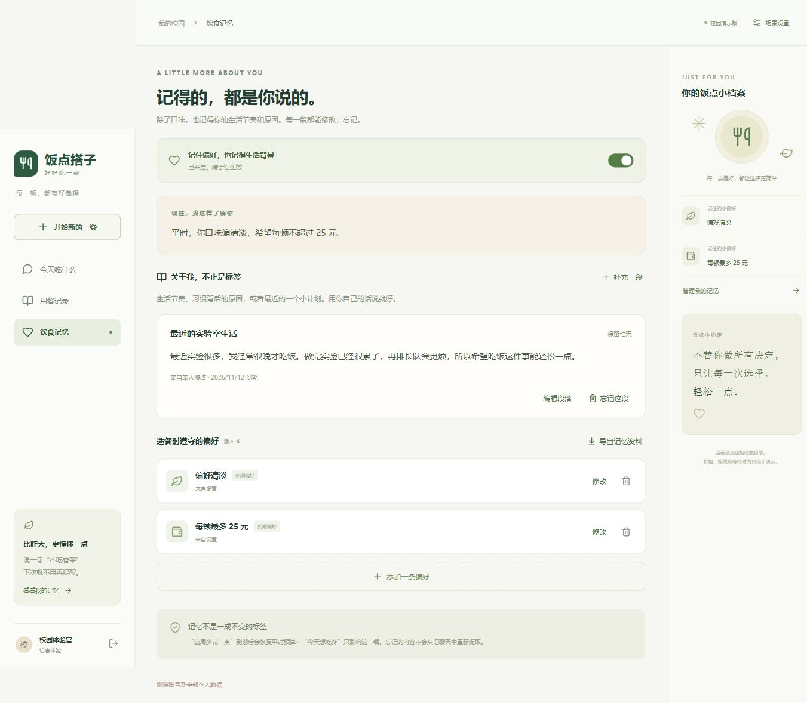

# 饭点搭子 · 校园吃饭决策 Chatbot

[下载 Windows 桌面版](https://github.com/leeskywalker060726-star/fandian-dazi/releases) · [桌面使用说明](docs/桌面版.md) · [MIT License](LICENSE)

一个记得生活背景的校园吃饭聊天伙伴。支持自然闲聊、按需推荐、多轮追问、可编辑的段落记忆，以及预算和忌口的确定性筛选。

## 桌面版

下载 Release 中的 Windows x64 ZIP，解压整个目录，双击 `FandianDazi.exe`。无需安装 Python、Node 或 MySQL；需要 Microsoft Edge WebView2 Runtime。

内置本地数据库，个人数据留在自己的电脑。右上角“模型设置”可连接兼容 Chat Completions 的模型服务；密钥由 Windows 加密保存。未配置时可体验基础规则选餐。调用外部模型时会发送本轮聊天与相关有效记忆。

## 首次使用：在 App 内配置自己的 API Key

**仓库和桌面发行包不包含 DeepSeek API Key。AI 聊天需要你自行配置；未配置时仅提供基础规则选餐，不会调用模型。**

1. 打开桌面 App，选择访客体验或注册本地账号，完成偏好设置。
2. 点击右上角 **“连接聊天模型”**（配置后显示“模型设置”）。
3. 使用 DeepSeek 时，服务地址填写 `https://api.deepseek.com`，模型名称填写 `deepseek-flash` 或你账号可用的其他模型 ID，API Key 填写你自己的密钥。不要在地址后添加 `/chat/completions`。[DeepSeek 官方配置说明](https://api-docs.deepseek.com/)
4. 点击“保存设置”，下一条消息即可使用模型。保存不会自动发起计费请求；是否可调用取决于密钥、模型权限、余额和网络。

密钥通过 Windows DPAPI 加密保存在 `%LOCALAPPDATA%\FandianDazi\settings.json`，绑定当前 Windows 用户；界面不会回显密钥。**桌面版不读取项目 `.env`，也不继承开发机环境变量里的模型密钥。** 更换电脑需重新配置；可以在模型设置里清除密钥。不要把 `.env`、`settings.json`、数据库或含密钥截图上传到 GitHub。

使用外部模型会发送本轮消息、有限对话上下文与相关有效记忆，费用由你填写的模型服务收取。

## 本版菜单

v0.3.0 附带[清洗后的菜单目录](data/catalog_meituan.json)，新安装默认启用。它来自 2026-11-02 的复旦大学北苑周边菜单快照：132 条正餐记录，其中 42 条参与初筛，90 条采集时库存为零的记录暂不推荐。包含采集日期与缺失信息标注，不包含平台图片、原始采集压缩包或个人数据。

这不是美团官方应用或实时接口。包装费、营业状态、库存、辣度和配料仍需向商户确认；选择餐食不会下单。数据字段与更新/切换方式见[菜单接入说明](docs/本地菜单接入.md)。

## 从源码运行网页版

需要 Python 3.13 和 Node.js 24：

```powershell
python -m venv .venv
.venv\Scripts\python.exe -m pip install -r requirements.lock.txt
npm ci
npm run build
.venv\Scripts\python.exe -m uvicorn apps.api.main:app --host 127.0.0.1 --port 8000
```

打开 <http://127.0.0.1:8000>。默认使用 SQLite。源码网页版供开发调试，可在本机 `.env` 配置 MySQL 和模型；`.env.example` 中的密钥为空，真实 `.env` 被 Git 忽略。希望通过界面配置模型时，请使用桌面 App，或运行 `.venv\Scripts\python.exe -m desktop.main`（需先安装 `requirements-desktop.txt`）。网页版不开放修改服务器级模型密钥的公共接口。

```powershell
# 测试
.venv\Scripts\python.exe -m pytest -q
# 构建 Windows 桌面发行包
.\scripts\build-desktop.ps1
```

## 实现与边界

React + TypeScript / FastAPI / SQLAlchemy / MySQL 或 SQLite / MCP / pywebview。

- 聊天先识别意图，仅明确选餐时查询目录和展示卡片。
- 记忆包括预算、忌口、自然语言概览及本人生活背景段落；支持确认、有效期、编辑、忘记、Skill ZIP 导出。
- 推荐金额、完整用餐时间和忌口由后端筛选；模型负责理解和自然语言回复。
- 新安装默认使用随仓库附带的历史菜单快照；可以[导入其他快照或切回虚构演示目录](docs/本地菜单接入.md)。明确标注采集时间、未知费用与待确认信息。路线和天气仍为演示，不会代替下单。
- 尚无 RAG、真实课表天气、自动更新或数字签名。请勿视为已完成生产部署加固。



- [运行说明与实现边界](docs/运行说明.md)
- [开发计划](docs/开发计划.md)
- [产品设计](docs/产品设计.md)
- [全栈架构](docs/全栈架构设计.md)
- [贡献指南](CONTRIBUTING.md) · [安全说明](SECURITY.md) · [第三方许可](THIRD_PARTY_NOTICES.md)

以下为产品最初的设想与场景示例，示例餐食和数值为虚构，尚未实现的能力以运行说明为准。

校园里每天最大的难题之一，不是没饭吃，而是饭点选择太多、信息太散：食堂哪个档口排队短、今天有什么菜、外卖哪家满减后更便宜、配送要多久，还要兼顾课表、预算、口味和健康。大家往往要在食堂、外卖平台、群消息之间反复横跳，最后花十几分钟还是随便选了一个。

我们的产品解决的就是这个问题。

## 三个引导层

### 0. 开屏：它先知道你在哪、几点、什么天

不需要用户教它今天几点下课。打开那一刻就知道当前时间、定位（哪个校区、哪栋楼）、天气，课表有就读，没有就按时段推断。

所以第一句话不是「你想吃什么」，是：「11:35 刚下课，外面在下雨，最近的门走过去 6 分钟——先看食堂，还是点外卖？」

开屏标签一次点 5–8 个，分组给，不要只剩品类：

| 组 | 标签 |
|---|---|
| 目标 | 减脂、增肌、控糖、吃好点、随便吃饱 |
| 口味 | 麻辣、清淡、重口、酸辣、甜口 |
| 预算 | 15 内、25 左右、35、不设限 |
| 节奏 | 赶时间、慢慢吃、边走边吃 |
| 场景 | 一人食、和同学、早饭、夜宵 |
| 忌口 | 不吃辣、不吃香菜、不吃牛羊、素食 |
| 品类 | 米饭、面食、轻食、汤、奶茶咖啡 |

标签不是拿来分类的，是让新用户的第一轮对话有输入。品类排最后，因为「想吃什么」本来就是大多数人答不上来的那个问题。

### 1. 对话中：一次只问一个

缺什么问什么，而且只问系统不知道的：几个人、想吃饱还是想省钱。已知的不问（时间、地点、天气）。有默认答案的用确认句（「还是 25？」）。问对了，答案就短了。

追问不重启对话：「换一家」「便宜点」「太辣了」，都在同一轮上下文里改条件重算。

### 2. 长期：记忆，以及它主动开口

它记得你的目标、口味、预算、忌口，也记得你点了什么、拒了什么、给了什么评价。所以它会在你没问的时候说话：

- 「这周三顿都是奶茶，晚上还有课到九点——换轻食那家？25 能吃饱，20 分钟到。」
- 「今天下雨，走过去要淋一段，外卖满减后跟食堂差不多。」
- 「这个月外卖花了 480，比上月多 170，月底这几天 15 块一顿够。」

你说的话它也存着，不是这一轮用完就忘。「我在减脂」「不吃香菜」「这周手头紧」「最近老熬夜」，说一次就沉下来，之后每次推荐都算进去。说错了也能改，「我不减脂了」「以后别推奶茶」，一句就改过来。

所以它问得越来越少，原因只有一个：它越来越清楚你要什么。第一次它得问你几点下课、能花多少钱、吃不吃辣；到第五次，它只问一句「今天食堂还是外卖」。需求是一句一句攒出来的，很少能一次问清，这也是用得越久越省力的原因。

想减脂的时候，它往轻食和低油那边推；连着几天熬夜的，它把「吃了不困」的往前排。

## 一次回答长什么样

条件不同，出来的东西完全不同。下面五段都是虚拟示例，重点看**它凭什么这么答**。

**① 减脂期，中午只有 25 分钟**

> 你：最近想瘦，中午别太油。
> 它：食堂二楼清蒸鱼那档，12 块，油少；外卖的鸡胸沙拉 28，蛋白高但 40 分钟才到。今天中午只剩 25 分钟，吃食堂——这顿 480 大卡左右，比上周三顿盖饭少一半。

**② 月底，只想省**

> 你：这周能省就省。
> 它：食堂一楼两素一荤套餐 9.8，比外卖最便宜的饭盒再省 8 块。这周你在外卖上花了 86，照这个速度月底要超 120。

**③ 下课赶下一节，还下雨**

你说：「12 点下课，20 以内，不想排队，清淡点。」

| 方案 | 花多少 | 等多久 | 来不来得及 |
|---|---|---|---|
| 食堂 A 清淡窗口 | 20 元内 | 排 8 分钟，走过去 6 分钟 | 来得及，吃完还剩二十分钟 |
| 外卖 B（满减后） | 18 元 | 配送 35 分钟 | 赶不上 13:30 那节课 |

> 选食堂 A。省三块钱，还省二十分钟；外面在下雨，走过去有连廊，外卖得在门口等。B 留到晚上没课的时候点。

**④ 和同学一起，想坐下吃**

> 你：晚上三个人，想坐下来。
> 它：食堂三楼小炒人均 22，有四人桌；拼单那家人均 19，但要等 45 分钟、还得去门口接。三个人我建议食堂。

**⑤ 十点下课，食堂关了**

> 你：有点饿，想吃口热的。
> 它：这个点只剩便利店和两家夜宵档。麻辣烫 18 块，15 分钟到；想吃轻一点就关东煮 9 块，不用等。明天早上第一节有课，别吃太辣。
